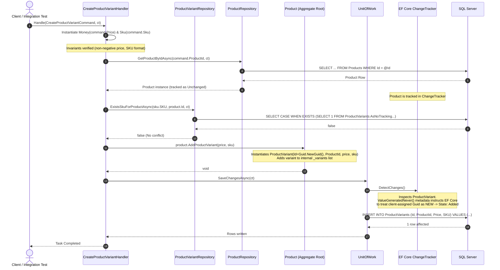
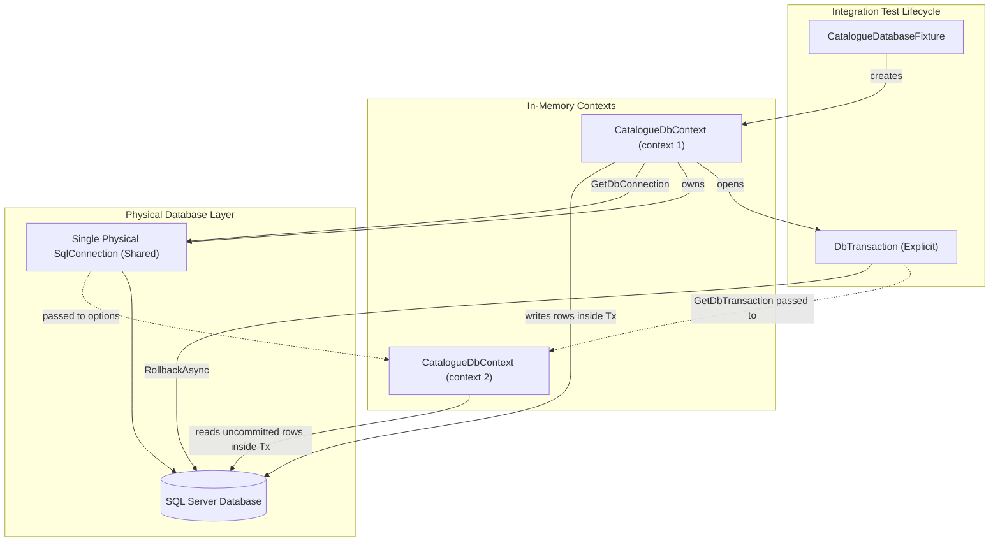

# Commerce Platform - Technical Architecture & Developer Handbook

> **Senior Architect & Technical Reference Manual**  
> Comprehensive documentation of design patterns, Domain-Driven Design modeling, Entity Framework Core internals, concurrency conflict resolution, and transactional integration testing.

---

## Table of Contents
1. [General Overview](#1-general-overview)
   - [Business Problem](#business-problem)
   - [Platform Objectives](#platform-objectives)
   - [Technology Stack & Runtime Versions](#technology-stack--runtime-versions)
   - [Architectural Style: Modular Monolith vs Microservices](#architectural-style-modular-monolith-vs-microservices)
   - [Functional Modules Status](#functional-modules-status)
2. [Solution Architecture & Layering](#2-solution-architecture--layering)
   - [Projects & Dependency Hierarchy](#projects--dependency-hierarchy)
   - [Layer Responsibilities & Boundary Invariants](#layer-responsibilities--boundary-invariants)
   - [Architectural Topology (Mermaid)](#architectural-topology-mermaid)
   - [End-to-End Execution Flow: Variant Creation (Mermaid)](#end-to-end-execution-flow-variant-creation-mermaid)
3. [Domain-Driven Design (DDD) & Business Modeling](#3-domain-driven-design-ddd--business-modeling)
   - [Entities vs Value Objects](#entities-vs-value-objects)
   - [Encapsulation & State Mutation Invariants](#encapsulation--state-mutation-invariants)
   - [Identity Generation Strategy in Domain Constructors](#identity-generation-strategy-in-domain-constructors)
   - [Private Parameterless Constructors for ORM Materialization](#private-parameterless-constructors-for-orm-materialization)
   - [Aggregate Roots & Child Entities (`Product` and `ProductVariant`)](#aggregate-roots--child-entities-product-and-productvariant)
   - [Why `product.AddProductVariant()` Supersedes Direct Collection Mutation](#why-productaddproductvariant-supersedes-direct-collection-mutation)
4. [Repository Pattern & Unit of Work Internals](#4-repository-pattern--unit-of-work-internals)
   - [Role and Intent of the Repository Abstraction](#role-and-intent-of-the-repository-abstraction)
   - [Interface in Application vs Implementation in Infrastructure](#interface-in-application-vs-implementation-in-infrastructure)
   - [Role of DbContext and the ChangeTracker](#role-of-dbcontext-and-the-changetracker)
   - [The Unit of Work Pattern](#the-unit-of-work-pattern)
   - [Context Lifetime Sharing Across Repositories and Unit of Work](#context-lifetime-sharing-across-repositories-and-unit-of-work)
   - [Implicit vs Explicit Transactions: `SaveChangesAsync()` vs `CommitAsync()`](#implicit-vs-explicit-transactions-savechangesasync-vs-commitasync)
   - [Code Walkthrough: `CreateProductVariantHandler`](#code-walkthrough-createproductvarianthandler)
5. [Entity Framework Core Deep Dive: Configuration & Engine Mechanics](#5-entity-framework-core-deep-dive-configuration--engine-mechanics)
   - [Fluent Configurations (`IEntityTypeConfiguration<T>`)](#fluent-configurations-ientitytypeconfigurationt)
   - [Keys, Indexes, and Constraints](#keys-indexes-and-constraints)
   - [Value Conversions (`HasConversion`) for Domain Value Objects](#value-conversions-hasconversion-for-domain-value-objects)
   - [Decimal Precision & Column Typing](#decimal-precision--column-typing)
   - [Foreign Keys & Delete Behaviors (`Cascade` vs `Restrict`)](#foreign-keys--delete-behaviors-cascade-vs-restrict)
   - [Encapsulated Backing Fields and Collection Navigations](#encapsulated-backing-fields-and-collection-navigations)
   - [Database Migrations & SQL Server Schema Evolution](#database-migrations--sql-server-schema-evolution)
6. [Case Study: Resolving `DbUpdateConcurrencyException` on Variant Creation](#6-case-study-resolving-dbupdateconcurrencyexception-on-variant-creation)
   - [Context of the Failure](#context-of-the-failure)
   - [Observed Symptom in ChangeTracker](#observed-symptom-in-changetracker)
   - [ChangeTracker Entity States Explained](#changetracker-entity-states-explained)
   - [Step-by-Step Diagnostic Investigation](#step-by-step-diagnostic-investigation)
   - [Root Cause Analysis: Guid Key Generation Conventions](#root-cause-analysis-guid-key-generation-conventions)
   - [The Fix: Explicit Metadata with `ValueGeneratedNever()`](#the-fix-explicit-metadata-with-valuegeneratednever)
   - [Architectural Lessons & Guidelines](#architectural-lessons--guidelines)
7. [Testing Strategy: Unit Testing vs Integration Testing](#7-testing-strategy-unit-testing-vs-integration-testing)
   - [Unit Tests with Moq & xUnit](#unit-tests-with-moq--xunit)
   - [What Unit Tests Validate vs What They Cannot Catch](#what-unit-tests-validate-vs-what-they-cannot-catch)
   - [Integration Testing with Real SQL Server and Fixtures](#integration-testing-with-real-sql-server-and-fixtures)
   - [The `CatalogueDatabaseFixture` Lifecycle (`IAsyncLifetime`)](#the-cataloguedatabasefixture-lifecycle-iasynclifetime)
8. [Case Study: Transaction Management Across Multiple DbContexts in Tests](#8-case-study-transaction-management-across-multiple-dbcontexts-in-tests)
   - [The Challenge: Verifying Persistence without Leaking Test Data](#the-challenge-verifying-persistence-without-leaking-test-data)
   - [Transactional Primitives: `BeginTransactionAsync`, `RollbackAsync`, `DisposeAsync`](#transactional-primitives-begintransactionasync-rollbackasync-disposeasync)
   - [The Two-DbContext Problem](#the-two-dbcontext-problem)
   - [Sharing the Underlying Physical Connection & Enlisting via `UseTransactionAsync`](#sharing-the-underlying-physical-connection--enlisting-via-usetransactionasync)
   - [Connection & Transaction Sharing Topology (Mermaid)](#connection--transaction-sharing-topology-mermaid)
9. [Setup, Execution & Operations Guide](#9-setup-execution--operations-guide)
   - [Prerequisites](#prerequisites)
   - [Database Provisioning with Docker Compose](#database-provisioning-with-docker-compose)
   - [Configuration & Connection Strings](#configuration--connection-strings)
   - [CLI Commands: Restore, Build, Run, Test](#cli-commands-restore-build-run-test)
   - [EF Core Migration Commands](#ef-core-migration-commands)
   - [Important Workspace Hygiene Notice](#important-workspace-hygiene-notice)
10. [Architectural Decision Records (ADRs) & Incident Log](#10-architectural-decision-records-adrs--incident-log)
    - [ADR-001: Scoped Lifetime Sharing between DbContext, Repositories, and UnitOfWork](#adr-001-scoped-lifetime-sharing-between-dbcontext-repositories-and-unitofwork)
    - [ADR-002: Client/Domain-Side Guid Generation](#adr-002-clientdomain-side-guid-generation)
    - [ADR-003: Explicit `ValueGeneratedNever()` on Domain-Identified Entities](#adr-003-explicit-valuegeneratednever-on-domain-identified-entities)
    - [ADR-004: Strongly Typed Value Objects with Two-Way EF Core Value Conversions](#adr-004-strongly-typed-value-objects-with-two-way-ef-core-value-conversions)
    - [ADR-005: Encapsulation of Aggregate Collections via Read-Only Interfaces](#adr-005-encapsulation-of-aggregate-collections-via-read-only-interfaces)
    - [ADR-006: Transaction Sharing Across Test DbContexts via Connection Enlistment](#adr-006-transaction-sharing-across-test-dbcontexts-via-connection-enlistment)
11. [Technical Roadmap & Engineering Backlog](#11-technical-roadmap--engineering-backlog)

---

## 1. General Overview

### Business Problem
Modern e-commerce platforms must manage multi-tenant catalog hierarchies where companies offer products with diverse specifications, variations, and pricing schemes. Core domain invariants—such as stock keeping unit (SKU) normalization, non-negative price definitions, and scoping SKU uniqueness strictly within parent products—must be guaranteed deterministically by the domain core rather than delegated to UI forms or database constraints alone.

### Platform Objectives
The `Commerce-Platforme` codebase implements the core domain foundation of this platform. It currently establishes:
- Formal business entity modeling for multi-tenant companies, catalog products, and item variations.
- Persistence and change tracking through clean abstractions.
- Automated validation of invariant preservation under transactional guarantees.

### Technology Stack & Runtime Versions
- **Platform Runtime**: .NET 9 (`net9.0`)
- **Language**: C# 13 with Nullable Reference Types (`Nullable: enable`) and implicit usings (`ImplicitUsings: enable`)
- **Data Access & ORM**: Microsoft Entity Framework Core 9 (`9.0.22`)
- **Database Engine**: Microsoft SQL Server 2022 (Linux container `mcr.microsoft.com/mssql/server:2022-latest`)
- **Web API**: ASP.NET Core 9 Web API (`Microsoft.AspNetCore.OpenApi 9.0.11`)
- **Test Frameworks & Utilities**:
  - `xunit 2.9.2` with `xunit.runner.visualstudio 2.8.2`
  - `Microsoft.NET.Test.Sdk 17.12.0`
  - `Moq 4.21.0`
  - `coverlet.collector 6.0.2`

### Architectural Style: Modular Monolith vs Microservices
The system is implemented as a **Modular Monolith in its foundational phase**, centered on the `Catalogue` bounded context.

| Dimension | Modular Monolith (This Repository) | Microservices Architecture |
| :--- | :--- | :--- |
| **Deployment Unit** | Single hostable Web API process (`CommercePlatform.Api`). | Independent distributable services deployed to isolated containers/nodes. |
| **In-Process vs Network Calls** | Synchronous domain dispatch, in-memory command invocation, and in-process DI resolution. | Inter-service calls through gRPC, REST, or message brokers (RabbitMQ/Kafka). |
| **Data Storage Topology** | Shared single database (`CommerceCatalogue`), separated logically by schema or tables. | Decentralized database-per-service topology. |
| **Transaction Boundary** | In-process relational transactions (`IDbContextTransaction`) managed by `CatalogueDbContext`. | Distributed transactions requiring 2-Phase Commit (2PC) or Outbox/Saga orchestrations. |
| **Current State in Repo** | The codebase is structured by bounded context prefixes (`Catalogue.*`), designed to enforce domain boundaries within a single deployable assembly. | *Not present.* No container orchestrations, service discovery, or RPC contracts exist. |

> [!NOTE]
> Labelling this codebase as "Microservices" would be technically inaccurate. It embodies the high-cohesion, low-coupling design of a Clean Architecture / Modular Monolith, which preserves boundaries without incurring distributed-systems overhead prematurely.

### Functional Modules Status

```
┌─────────────────────────────────────────────────────────────┐
│                       CommercePlatform                      │
│                                                             │
│   ┌─────────────────────────────────────────────────────┐   │
│   │                 [Catalogue Module]                  │   │
│   │                                                     │   │
│   │  [Company]  ──1:N──►  [Product]  ──1:N──► [Variant] │   │
│   │                                                     │   │
│   │  Status: Implemented (Domain, Persist, Handler)     │   │
│   └─────────────────────────────────────────────────────┘   │
│                                                             │
│   ┌──────────────────┐  ┌──────────────────┐  ┌──────────┐  │
│   │ [Orders Module]  │  │ [Cart / Checkout]│  │ [Auth]   │  │
│   │ Status: Planned  │  │ Status: Planned  │  │ Status:  │  │
│   │ (Not Implemented)│  │ (Not Implemented)│  │ Planned │  │
│   └──────────────────┘  └──────────────────┘  └──────────┘  │
└─────────────────────────────────────────────────────────────┘
```

- **Implemented Functionality**:
  - Company root definition (`Company` entity).
  - Product catalog entity (`Product` aggregate root).
  - Product variation entity (`ProductVariant`) with custom value objects (`Money`, `Sku`).
  - Command handling pipeline: `CreateProductVariantCommand` executed via `CreateProductVariantHandler`.
  - Persistence layer: `CatalogueDbContext`, entity configurations, and SQL Server repositories.
  - Comprehensive unit test suite (Domain entity tests and Application handler tests with Moq).
  - Integration test suite running real transactions on a live SQL Server instance.
- **Not Yet Implemented / Incomplete**:
  - API Controllers: `CommercePlatform.Api` defines routing and pipeline infrastructure (`app.MapControllers()`), but the `Controllers/` directory contains no controllers. HTTP endpoints for Product Variant operations are pending.
  - MediatR / Command Bus: Handlers are wired directly as regular classes rather than decoupled through an in-memory mediator library.
  - Modules such as `Orders`, `Inventory`, `Customers`, and `Billing` are completely absent from this repository.

---

## 2. Solution Architecture & Layering

### Projects & Dependency Hierarchy
The solution follows the strict dependency direction of Clean Architecture: inner layers never reference outer layers.

```
       Catalogue.Domaine  ◄─────────  (Pure C#, Zero External Dependencies)
               ▲
               │ references
       Catalogue.Application  (Depends only on Domain)
               ▲
               │ references
       Catalogue.Infrastructure (EF Core, SQL Server, Persistence Repositories)
               ▲
               │ references
       CommercePlatform.Api  (Entry point, Dependency Injection Host)
```

The test project `Catalogue.Tests` references `Catalogue.Domaine` and `Catalogue.Infrastructure` (which transitively provides access to `Catalogue.Application`).

### Layer Responsibilities & Boundary Invariants

#### 1. Domain Layer (`Catalogue.Domaine`)
- **Role**: Heart of the business logic and state invariants.
- **Permitted Responsibilities**:
  - Business entities (`Company`, `Product`, `ProductVariant`).
  - Value Objects (`Money`, `Sku`).
  - Domain validation and normalization rules.
- **Forbidden Responsibilities**:
  - No database concerns, no SQL references, no EF Core imports.
  - No HTTP or framing infrastructure.
  - No dependency on DI containers.
- **Dependencies**: None. Pure .NET standard library.

#### 2. Application Layer (`Catalogue.Application`)
- **Role**: Orchestrates use cases and coordinates domain workflows.
- **Permitted Responsibilities**:
  - Commands and Queries (e.g., `CreateProductVariantCommand`).
  - Command Handlers (e.g., `CreateProductVariantHandler`).
  - Persistence abstractions / Ports (`IProductRepository`, `IProductVariantRepository`, `ICompanyRepository`, `IUnitOfWork`).
  - Application-specific domain exceptions (`NotFoundException`, `ConflictException`).
- **Forbidden Responsibilities**:
  - Direct database querying, SQL generation, or ORM coupling.
  - HTTP request/response handling.
- **Dependencies**: `Catalogue.Domaine`.

#### 3. Infrastructure Layer (`Catalogue.Infrastructure`)
- **Role**: Technical adapter implementing abstractions defined in inner layers.
- **Permitted Responsibilities**:
  - EF Core `DbContext` implementation (`CatalogueDbContext`).
  - Fluent entity type configurations (`ProductConfiguration`, `ProductVariantConfiguration`, `CompanyConfiguration`).
  - Repository implementations (`ProductRepository`, `ProductVariantRepository`, `UnitOfWork`).
  - Database schema migrations.
- **Forbidden Responsibilities**:
  - Redefining business invariants outside domain configurations.
  - Direct presentation-layer coupling.
- **Dependencies**: `Catalogue.Application`, `Catalogue.Domaine`, `Microsoft.EntityFrameworkCore.SqlServer`, `Microsoft.EntityFrameworkCore.Tools`.

#### 4. Presentation / API Layer (`CommercePlatform.Api`)
- **Role**: HTTP hosting environment, configuration root, and dependency injection composition root.
- **Permitted Responsibilities**:
  - Composition root (`Program.cs` service registrations).
  - OpenApi / Swagger documentation setup.
  - Future HTTP controller endpoints.
- **Forbidden Responsibilities**:
  - Direct database operations bypassing repositories or handlers.
  - Leaking ORM models directly to HTTP consumers.
- **Dependencies**: `Catalogue.Infrastructure`, `Microsoft.AspNetCore.OpenApi`.

#### 5. Tests Layer (`Catalogue.Tests`)
- **Role**: Automated quality gate validating unit behavior and relational persistence integrity.
- **Permitted Responsibilities**:
  - Pure unit tests for Domain models and Application Handlers.
  - Mocking interfaces via `Moq`.
  - Full-stack relational integration testing against SQL Server using `CatalogueDatabaseFixture`.
- **Dependencies**: `Catalogue.Infrastructure`, `Catalogue.Domaine`, `xunit`, `Moq`, `Microsoft.EntityFrameworkCore.Relational`.

---

### Architectural Topology (Mermaid)

```mermaid
graph TD
    subgraph Presentation ["Presentation Layer (CommercePlatform.Api)"]
        Program["Program.cs (Composition Root)"]
    end

    subgraph Application ["Application Layer (Catalogue.Application)"]
        Handler["CreateProductVariantHandler"]
        Command["CreateProductVariantCommand"]
        IProdRepo["interface IProductRepository"]
        IVarRepo["interface IProductVariantRepository"]
        IUoW["interface IUnitOfWork"]
    end

    subgraph Domain ["Domain Layer (Catalogue.Domaine)"]
        Product["Product (Aggregate Root)"]
        Variant["ProductVariant (Entity)"]
        Company["Company (Entity)"]
        Money["Money (Value Object)"]
        Sku["Sku (Value Object)"]
    end

    subgraph Infrastructure ["Infrastructure Layer (Catalogue.Infrastructure)"]
        Context["CatalogueDbContext"]
        ProdRepo["ProductRepository"]
        VarRepo["ProductVariantRepository"]
        UoW["UnitOfWork"]
        Config["EntityTypeConfigurations"]
    end

    subgraph External ["External Infrastructure"]
        SQLServer[("Microsoft SQL Server")]
    end

    Program --> Context
    Program --> ProdRepo
    Program --> VarRepo
    Program --> UoW
    Program --> Handler

    Handler --> Command
    Handler --> IProdRepo
    Handler --> IVarRepo
    Handler --> IUoW
    Handler --> Product
    Handler --> Money
    Handler --> Sku

    ProdRepo -.->|implements| IProdRepo
    VarRepo -.->|implements| IVarRepo
    UoW -.->|implements| IUoW

    ProdRepo --> Context
    VarRepo --> Context
    UoW --> Context
    Context --> Config
    Context --> SQLServer

    Product "1" *-- "many" Variant : manages
    Product --> Company
    Variant --> Money
    Variant --> Sku
```

---

### End-to-End Execution Flow: Variant Creation (Mermaid)



---

## 3. Domain-Driven Design (DDD) & Business Modeling

The domain model contains three main concepts: `Company`, `Product`, and `ProductVariant`, supplemented by Value Objects: `Money` and `Sku`.

### Entities vs Value Objects

```
┌──────────────────────────────────────┐     ┌──────────────────────────────────────┐
│           Domain Entity              │     │             Value Object             │
│        (e.g., ProductVariant)        │     │              (e.g., Sku)             │
├──────────────────────────────────────┤     ├──────────────────────────────────────┤
│ - Identity: Has a unique Guid Id     │     │ - Identity: Possesses NO identity    │
│ - Equality: Evaluated by Id          │     │ - Equality: Evaluated by structural  │
│ - Mutability: State may change over  │     │   values (C# record equality)        │
│   time while preserving Id identity  │     │ - Immutability: Deeply immutable;    │
│ - Lifecycle: Maintained in table     │     │   state changes require a new object │
└──────────────────────────────────────┘     └──────────────────────────────────────┘
```

#### 1. Value Object: `Sku` (`Catalogue.Domaine.Entities.ValueObjects.Sku.cs`)
```csharp
public record Sku
{
    public string SKU { get; private init; }

    public Sku(string sku)
    {
        var skuFormatValidation = IsFormatValide(sku);
        if (!skuFormatValidation.isValid)
            throw new ArgumentException("Sku format is invalide");

        SKU = skuFormatValidation.normalizedSku!;
    }

    private (bool isValid, string? normalizedSku) IsFormatValide(string sku)
    {
        if (string.IsNullOrWhiteSpace(sku))
            return (false, null);

        sku = sku.Trim().ToUpperInvariant().Normalize();
        return (Regex.IsMatch(sku, @"^[a-zA-Z0-9_-]+$"), sku);
    }
}
```
- **Invariants**: Must not be empty, whitespace, or contain non-alphanumeric characters (hyphens and underscores allowed). Automatically trimmed and converted to uppercase.
- **Type**: C# `record`, ensuring value-based equality.

#### 2. Value Object: `Money` (`Catalogue.Domaine.Entities.ValueObjects.Money.cs`)
```csharp
public record Money
{
    public decimal Price { get; private init; }

    public Money(decimal price)
    {
        if (price < 0)
            throw new ArgumentException("Price cannot be lower than 0");

        Price = price;
    }
}
```
- **Invariants**: Monetary amount cannot be negative (`price < 0`).
- **Equality**: Two `Money` instances with the same decimal amount evaluate as equal (`Assert.Equal(price1, price2)`).

---

### Encapsulation & State Mutation Invariants
The entities do not expose public parameterless setters. All mutations must occur via explicit, intention-revealing domain methods:

- `Company.Rename(string name)`: Validates that the company name cannot be null, empty, or whitespace. Trims formatting.
- `Product.Rename(string productName)`: Enforces non-empty naming rules.
- `Product.AddProductVariant(Money price, Sku sku)`: Ensures variants cannot be added to a product without valid value objects and associates the variant directly with the product's identity.

```csharp
// Excerpt from Product.cs
public class Product
{
    public Guid Id { get; private set; }
    public Guid CompanyId { get; private set; }
    public string Name { get; private set; } = string.Empty;
    public Company Company { get; set; }
    
    private readonly List<ProductVariant> _variants = new();
    public IReadOnlyCollection<ProductVariant> ProductVariants => _variants;

    public void AddProductVariant(Money price, Sku sku)
    {
        ProductVariant productVariant = new(Id, price, sku);
        _variants.Add(productVariant);
    }
}
```

### Identity Generation Strategy in Domain Constructors
Rather than relying on database identity sequences (`IDENTITY(1,1)`) or database-generated GUIDs (`NEWID()`), identifiers in this project are generated directly inside entity constructors:

```csharp
// Constructor in Product.cs
public Product(Guid companyId, string productName) 
{
    if (companyId == Guid.Empty)
        throw new ArgumentException("CompanyId cannot by empty");

    Rename(productName);
    Id = Guid.NewGuid(); // Domain-generated identity
    CompanyId = companyId;
}

// Constructor in ProductVariant.cs
public ProductVariant(Guid productId, Money price, Sku sku)
{
    if (productId == Guid.Empty)
        throw new ArgumentException("ProductId cannot by empty");

    SKU = sku;
    if (price is null)
        throw new ArgumentException("Price cannot be null");

    Id = Guid.NewGuid(); // Domain-generated identity
    ProductId = productId;
    Price = price;
}
```

**Benefits of Client/Domain-Side Identity Generation:**
1. **Immediate Referenceability**: The aggregate can create child entities, publish domain events with IDs, or correlate transactions in memory before hitting the database.
2. **Batch Persistence Optimization**: EF Core can insert parent and child entities in a single roundtrip without needing roundtrips to retrieve server-generated IDs.

---

### Private Parameterless Constructors for ORM Materialization
Both `Product`, `ProductVariant`, and `Company` define private parameterless constructors:

```csharp
private Product()
{
}

private ProductVariant()
{
}

private Company()
{
}
```

- **Mechanism**: When EF Core retrieves rows from SQL Server, it needs to materialize an object instance without invoking business validation constructors. It uses reflection to instantiate the entity via this private parameterless constructor, then assigns properties via their private setters or backing fields.
- **Encapsulation Protection**: By declaring these constructors `private`, consumers outside the class (e.g., application handlers, tests) are prevented from instantiating invalid, uninitialized entities.

---

### Aggregate Roots & Child Entities (`Product` and `ProductVariant`)
In Domain-Driven Design, an **Aggregate** is a cluster of domain objects that can be treated as a single unit for data changes. Every Aggregate has a single **Aggregate Root**:
- `Product` acts as the Aggregate Root.
- `ProductVariant` is an internal entity belonging strictly to the `Product` boundary.
- External callers must not manipulate `ProductVariant` independently of its parent `Product`.

```
┌────────────────────────────────────────────────────────┐
│                   Product Aggregate                    │
│                                                        │
│   ┌────────────────────────────────────────────────┐   │
│   │           Product (Aggregate Root)             │   │
│   │   - Id: Guid                                   │   │
│   │   - CompanyId: Guid                            │   │
│   │   - Name: string                               │   │
│   └──────────────────────┬─────────────────────────┘   │
│                          │ 1                           │
│                          │ owns & controls             │
│                          ▼ *                           │
│   ┌────────────────────────────────────────────────┐   │
│   │             ProductVariant (Child)             │   │
│   │   - Id: Guid                                   │   │
│   │   - SKU: Sku (Value Object)                    │   │
│   │   - Price: Money (Value Object)                │   │
│   └────────────────────────────────────────────────┘   │
└────────────────────────────────────────────────────────┘
```

---

### Why `product.AddProductVariant()` Supersedes Direct Collection Mutation

In `CreateProductVariantHandler`, the variant is added as follows:
```csharp
product.AddProductVariant(price, sku);
```
rather than:
```csharp
// Anti-pattern:
// product.ProductVariants.Add(new ProductVariant(...));
```

#### Technical Comparison:

| Criteria | Aggregate Method (`AddProductVariant`) | Direct Collection Modification (`.Add()`) |
| :--- | :--- | :--- |
| **Invariant Enforcement** | Guaranteed. The root controls child instantiation, guarantees `ProductId` linkage, and can enforce aggregate-wide rules. | Compromised. External handlers could add variants with arbitrary foreign keys, invalid SKUs, or bypass root invariants. |
| **Encapsulation** | `ProductVariants` is exposed as `IReadOnlyCollection<ProductVariant>`, preventing external callers from calling `.Add()` or `.Clear()`. | Requires exposing `List<ProductVariant>` publicly, making entity state mutable from anywhere in the codebase. |
| **Ubiquitous Language** | Expresses explicit domain intent: a product creates and assimilates its variant. | Expresses raw data manipulation without domain semantic meaning. |

**Trade-offs & Boundaries:**
- *Advantage*: High domain integrity, zero leakage of business rules into application handlers.
- *Limitation*: To check for SKU uniqueness across the entire database without loading every variant of every product into memory, the handler must perform a targeted database query (`ExistsSkuForProductAsync`) prior to invoking the aggregate root method.

---

## 4. Repository Pattern & Unit of Work Internals

### Role and Intent of the Repository Abstraction
The Repository pattern isolates the application logic from data access details. The Application layer expresses what data it needs through domain contracts, while the Infrastructure layer determines how that data is retrieved.

### Interface in Application vs Implementation in Infrastructure
Following the **Dependency Inversion Principle (DIP)**:
- High-level modules (`Catalogue.Application`) define the interfaces:
  - `IProductRepository`
  - `IProductVariantRepository`
  - `ICompanyRepository`
  - `IUnitOfWork`
- Low-level modules (`Catalogue.Infrastructure`) implement them:
  - `ProductRepository : IProductRepository`
  - `ProductVariantRepository : IProductVariantRepository`
  - `UnitOfWork : IUnitOfWork`

This structure ensures that the Application layer contains zero references to EF Core, SQL Server, or relational database drivers.

---

### Role of DbContext and the ChangeTracker

#### 1. `CatalogueDbContext`
The `DbContext` represents a combination of the Unit of Work and Repository patterns provided by EF Core. It manages database connections, executes commands against SQL Server, and manages entity state mapping.

#### 2. The `ChangeTracker`
The `ChangeTracker` is EF Core's state machine. Every entity loaded from a query (without `.AsNoTracking()`) or added to a `DbSet` is monitored. The tracker tracks:
- The entity's original property values.
- Its current property values.
- Its current `EntityState` (`Added`, `Unchanged`, `Modified`, `Deleted`, `Detached`).

---

### The Unit of Work Pattern
The Unit of Work pattern coordinates writes across multiple repositories by tracking changes and committing them in a single atomic database operation.

In this codebase, `IUnitOfWork` defines:
```csharp
namespace Catalogue.Application.Common.Abstractions.Persistence
{
    public interface IUnitOfWork
    {
        Task<int> SaveChangesAsync(CancellationToken ct);
    }
}
```
The implementation in `UnitOfWork.cs` delegates directly to the underlying context:
```csharp
public class UnitOfWork : IUnitOfWork
{
    private readonly CatalogueDbContext _context;

    public UnitOfWork(CatalogueDbContext context)
    {
        _context = context;
    }

    public Task<int> SaveChangesAsync(CancellationToken ct)
    {
        return _context.SaveChangesAsync(ct);
    }
}
```

---

### Context Lifetime Sharing Across Repositories and Unit of Work
A fundamental design requirement in Clean Architecture with EF Core is that **all repositories and the Unit of Work within a single HTTP request or use case must share the exact same instance of `CatalogueDbContext`**.

In `CommercePlatform.Api/Program.cs`:
```csharp
builder.Services.AddDbContext<CatalogueDbContext>(opt =>
{
    opt.UseSqlServer(builder.Configuration.GetConnectionString("catalogueConnectionString"));
});

builder.Services.AddScoped<IUnitOfWork, UnitOfWork>();
builder.Services.AddScoped<IProductVariantRepository, ProductVariantRepository>();
builder.Services.AddScoped<IProductRepository, ProductRepository>();
```

- When registered with `.AddScoped<T>()`, the ASP.NET Core DI container creates one `CatalogueDbContext` per HTTP request.
- Both `ProductRepository`, `ProductVariantRepository`, and `UnitOfWork` receive that same context instance.
- **Why this is critical**: The `ChangeTracker` is contained *inside* that specific `CatalogueDbContext` instance. If `ProductRepository` loaded an entity using Context A, but `UnitOfWork` called `SaveChangesAsync()` on Context B, Context B's change tracker would be empty, and **no database changes would be written**.

---

### Implicit vs Explicit Transactions: `SaveChangesAsync()` vs `CommitAsync()`

```
┌────────────────────────────────────────────────────────────────────────┐
│                       Implicit Transaction                             │
│                  (Standard SaveChangesAsync)                           │
├────────────────────────────────────────────────────────────────────────┤
│ await _unitOfWork.SaveChangesAsync(ct);                                │
│                                                                        │
│ 1. EF Core automatically opens an internal SQL transaction.            │
│ 2. Sends all accumulated INSERT/UPDATE/DELETE commands to SQL Server.  │
│ 3. Commits the transaction if all commands succeed.                    │
│ 4. Rolls back automatically if any SQL error occurs.                   │
└────────────────────────────────────────────────────────────────────────┘

┌────────────────────────────────────────────────────────────────────────┐
│                       Explicit Transaction                             │
│             (context.Database.BeginTransactionAsync)                   │
├────────────────────────────────────────────────────────────────────────┤
│ await using var tx = await context.Database.BeginTransactionAsync(ct); │
│                                                                        │
│ 1. Opens an explicit IDbContextTransaction on the connection.          │
│ 2. Multiple SaveChangesAsync() calls can be issued sequentially.       │
│ 3. Changes are visible within the transaction, but isolated externally.│
│ 4. Requires tx.CommitAsync() to persist or tx.RollbackAsync() to abort.│
└────────────────────────────────────────────────────────────────────────┘
```

---

### Code Walkthrough: `CreateProductVariantHandler`

File: `Catalogue.Application/ProductVariants/Create/CreateProductVariantHandler.cs`

```csharp
public async Task Handle(CreateProductVariantCommand command, CancellationToken ct)
{
    // Step 1: Instantiate and validate Domain Value Objects
    Money price = new Money(command.Price);
    Sku sku = new Sku(command.Sku);

    // Step 2: Retrieve the parent aggregate root.
    // Notice: AsNoTracking() is NOT used because the aggregate root must be tracked
    // to discover child entities added to its internal collections.
    var product = await _productRepository.GetProductByIdAsync(command.ProductId, ct) 
        ?? throw new NotFoundException(nameof(Product), command.ProductId);

    // Step 3: Check uniqueness across the database using a targeted repository check
    var variantExisting = await _productVariantRepository.
        ExistsSkuForProductAsync(sku.SKU, product.Id, ct);

    if (variantExisting)
        throw new ConflictException
            ($"Variant with SKU {command.Sku} already existe in product with id {product.Id}");

    // Step 4: Mutate the Aggregate Root via its domain method
    product.AddProductVariant(price, sku);

    // Step 5: Persist changes atomically
    await _unitOfWork.SaveChangesAsync(ct);
}
```

---

## 5. Entity Framework Core Deep Dive: Configuration & Engine Mechanics

The persistence mappings are configured using EF Core's Fluent API in `Catalogue.Infrastructure/Configurations`.

### Fluent Configurations (`IEntityTypeConfiguration<T>`)
Rather than polluting domain entities with database attributes like `[Table]`, `[Key]`, or `[Column]`, configurations are isolated in dedicated classes implementing `IEntityTypeConfiguration<T>`.

In `CatalogueDbContext.cs`:
```csharp
protected override void OnModelCreating(ModelBuilder modelBuilder)
{
    base.OnModelCreating(modelBuilder);
    // Dynamically discovers and applies all IEntityTypeConfiguration classes in the Infrastructure assembly
    modelBuilder.ApplyConfigurationsFromAssembly(typeof(CatalogueDbContext).Assembly);
}
```

---

### Keys, Indexes, and Constraints

#### 1. Primary Keys (`HasKey`)
- `builder.HasKey(c => c.Id);` (Configured for `Company`, `Product`, `ProductVariant`).
- Maps to SQL Server clustered primary key constraint (`PK_ProductVariants`).

#### 2. Unique Composite Indexes (`HasIndex` + `IsUnique`)
In `ProductVariantConfiguration.cs`:
```csharp
builder.HasIndex(v => new { v.ProductId, v.SKU }).IsUnique();
```
- **Business Rule**: An individual SKU can exist across multiple products, but within the scope of a single product, each SKU must be strictly unique.
- **Index Column Order Optimization**:
  - The migration history shows that initially, index `IX_ProductVariants_SKU_ProductId` was placed on `(SKU, ProductId)`.
  - In migration `20261103141831_ChangeTheOrderOfColumnsInIndex`, the index was restructured to `(ProductId, SKU)` (`IX_ProductVariants_ProductId_SKU`).
  - **Reason**: Queries filtering by `ProductId` (such as listing variants for a specific product or verifying an existing SKU for a product) benefit directly from index seek operations because `ProductId` is the leading key column.

---

### Value Conversions (`HasConversion`) for Domain Value Objects
Relational databases do not have native types for domain Value Objects like `Sku` and `Money`. EF Core Value Converters bridge this gap:

```csharp
// Mapping Sku Value Object <-> nvarchar(50)
builder.Property(v => v.SKU)
    .IsRequired()
    .HasMaxLength(50)
    .HasConversion(
        sku => sku.SKU,                     // 1. Write: Converts Domain Sku to string for SQL Server
        skuValue => new Sku(skuValue)       // 2. Read:  Converts SQL Server string back into Domain Sku
    );

// Mapping Money Value Object <-> decimal(18,2)
builder.Property(v => v.Price)
    .IsRequired()
    .HasPrecision(18, 2)
    .HasConversion(
        price => price.Price,               // 1. Write: Converts Domain Money to decimal for SQL Server
        value => new Money(value)           // 2. Read:  Converts SQL Server decimal back into Domain Money
    );
```

---

### Decimal Precision & Column Typing
Without explicit precision, SQL Server defaults decimal values to `decimal(18, 2)`, but EF Core issues compiler warnings if precision is unspecified.
- `builder.Property(v => v.Price).HasPrecision(18, 2);`
- Ensures prices up to 16 integer digits and 2 decimal fractional places are preserved without silent truncation.

---

### Foreign Keys & Delete Behaviors (`Cascade` vs `Restrict`)

#### 1. Company -> Products (`DeleteBehavior.Restrict`)
```csharp
builder.HasOne(p => p.Company)
    .WithMany(c => c.Products)
    .HasForeignKey(p => p.CompanyId)
    .OnDelete(DeleteBehavior.Restrict);
```
- **Rule**: Deleting a `Company` that still has existing `Products` is rejected at the database level. Prevents accidental cascading loss of catalog data.

#### 2. Product -> ProductVariants (`DeleteBehavior.Cascade`)
```csharp
builder.HasOne(v => v.Product)
    .WithMany(p => p.ProductVariants)
    .HasForeignKey(v => v.ProductId)
    .OnDelete(DeleteBehavior.Cascade);
```
- **Rule**: A `ProductVariant` cannot exist without its parent `Product`. Deleting a `Product` automatically deletes all associated variations.

---

### Encapsulated Backing Fields and Collection Navigations
In `Product.cs`:
```csharp
private readonly List<ProductVariant> _variants = new();
public IReadOnlyCollection<ProductVariant> ProductVariants => _variants;
```
- EF Core detects the backing field `_variants` matching the navigation property `ProductVariants` by naming convention.
- When querying data, EF Core writes directly into the private `_variants` collection using reflection, bypassing public accessors while preserving domain encapsulation.

---

### Database Migrations & SQL Server Schema Evolution
The schema is tracked in `Catalogue.Infrastructure/Persistence/Migrations`:

```
20261103135142_InitialCreate.cs
  ├── Creates Companies table (PK Id, Name nvarchar(150))
  ├── Creates Products table (PK Id, FK CompanyId Restrict, Name nvarchar(150))
  └── Creates ProductVariants table (PK Id, FK ProductId Cascade, Price decimal(18,2), SKU nvarchar(max))
        ▼
20261103140507_AddUniqueSkuPerProduct.cs
  ├── Alters SKU column: nvarchar(max) -> nvarchar(50) (Required for indexing)
  └── Adds Unique Index: IX_ProductVariants_SKU_ProductId on (SKU, ProductId)
        ▼
20261103141831_ChangeTheOrderOfColumnsInIndex.cs
  ├── Drops IX_ProductVariants_ProductId and IX_ProductVariants_SKU_ProductId
  └── Creates composite unique index IX_ProductVariants_ProductId_SKU on (ProductId, SKU)
```

---

## 6. Case Study: Resolving `DbUpdateConcurrencyException` on Variant Creation

### Context of the Failure
During development of the `CreateProductVariantHandler` and its integration test, the following sequence executed:
1. An existing `Product` was retrieved via `_productRepository.GetProductByIdAsync()`.
2. The entity was loaded by `CatalogueDbContext` and tracked as `EntityState.Unchanged`.
3. The handler invoked `product.AddProductVariant(price, sku)`.
4. Inside the domain, `new ProductVariant(Id, price, sku)` assigned a new client-side `Guid` (`Id = Guid.NewGuid()`) and added the variant to `Product._variants`.
5. The handler called `await _unitOfWork.SaveChangesAsync(ct)`.
6. Instead of executing an `INSERT` statement, EF Core threw an unexpected **`DbUpdateConcurrencyException`**!

---

### Observed Symptom in ChangeTracker
Inspecting the diagnostic entries in `context.ChangeTracker.Entries()` immediately before `SaveChangesAsync()` revealed:

| Entity Type | Entity ID | Observed `EntityState` | Expected `EntityState` |
| :--- | :--- | :--- | :--- |
| `Company` | `...` | `Unchanged` | `Unchanged` |
| `Product` | `...` | `Unchanged` | `Unchanged` |
| **`ProductVariant`** | `...` | **`Modified`** | **`Added`** |

Because EF Core marked the freshly created `ProductVariant` as `Modified`, it issued an SQL `UPDATE` statement:
```sql
UPDATE [ProductVariants] 
SET [Price] = @p0, [ProductId] = @p1, [SKU] = @p2 
WHERE [Id] = @p3;
```
Since this variant had just been created in memory and did not exist in the database, the `UPDATE` statement affected **0 rows**. EF Core expects an update on an entity to affect exactly 1 row; when 0 rows are affected, it interprets this as a concurrency collision (the row was deleted or modified by another transaction) and raises a `DbUpdateConcurrencyException`.

---

### ChangeTracker Entity States Explained

```
                     ┌──────────────────┐
                     │     Detached     │ (Not tracked by DbContext)
                     └────────┬─────────┘
                              │
          Attach() / Query    │   context.Add() / Added to collection
         ┌────────────────────┼────────────────────────┐
         │                    │                        │
         ▼                    ▼                        ▼
┌──────────────────┐ ┌──────────────────┐    ┌──────────────────┐
│    Unchanged     │ │     Modified     │    │      Added       │
│                  │ │                  │    │                  │
│ In sync with DB  │ │ Property altered │    │ Pending INSERT   │
│ No SQL executed  │ │ Pending UPDATE   │    │                  │
└────────┬─────────┘ └────────┬─────────┘    └────────┬─────────┘
         │                    │                       │
         └────────────┬───────┴───────────────────────┘
                      │
                      │ context.Remove()
                      ▼
             ┌──────────────────┐
             │     Deleted      │
             │ Pending DELETE   │
             └──────────────────┘
```

- **`Added`**: Entity will be inserted into the database upon calling `SaveChangesAsync()`.
- **`Unchanged`**: Entity matches the database snapshot; no SQL emitted.
- **`Modified`**: Some or all property values have changed; an `UPDATE` will be emitted.
- **`Deleted`**: Entity is marked for deletion; a `DELETE` will be emitted.
- **`Detached`**: The entity is not tracked by the `ChangeTracker`.

---

### Step-by-Step Diagnostic Investigation
1. **ChangeTracker Inspection**: Calling `context.ChangeTracker.Entries()` exposed that `ProductVariant` had entered the `Modified` state rather than `Added`.
2. **Identification of the Culprit**: Why was a newly constructed instance evaluated as `Modified`?
3. **Guid Generation Analysis**: In `ProductVariant.cs`, the constructor explicitly set `Id = Guid.NewGuid()`.
4. **EF Core Convention Analysis**: By default, EF Core assumes that if an entity's primary key property has a non-default value (for a Guid, any value other than `Guid.Empty`), and the entity is discovered via a tracked navigation on an existing parent, **the entity must already exist in the database**. EF Core therefore marks it as `Modified`.

---

### Root Cause Analysis: Guid Key Generation Conventions
EF Core relies on key generation metadata to determine how entity keys are assigned:
- **Default Convention for Guids**: By default, EF Core configures Guid primary keys with `ValueGeneratedOnAdd()`. It expects the client to leave the key as `Guid.Empty`, which signals EF Core to generate the Guid or let the database generate it upon insertion (`Added`).
- **Conflict with Domain-Driven Design**: The domain model intentionally generated its own keys client-side inside the constructor (`Id = Guid.NewGuid()`).
- Because `Id != Guid.Empty`, EF Core assumed the entity was already stored in SQL Server and marked it `Modified`.

---

### The Fix: Explicit Metadata with `ValueGeneratedNever()`
To reconcile the domain's client-side key generation strategy with EF Core's change detection engine, the configuration was updated in `Catalogue.Infrastructure/Configurations/ProductVariantConfiguration.cs`:

```csharp
builder.HasKey(v => v.Id);

// Tells EF Core that the entity's ID is explicitly assigned by the application/domain
// and that EF Core must NOT consider a pre-populated Guid as proof that the record already exists in the DB.
builder.Property(v => v.Id).ValueGeneratedNever();
```

With `ValueGeneratedNever()` specified, when EF Core scans tracked navigation properties and encounters an entity instance not previously loaded by the `DbContext`, it assigns the state **`Added`** despite the non-empty `Guid`. On `SaveChangesAsync()`, EF Core generates the correct `INSERT` statement.

---

### Architectural Lessons & Guidelines
1. **Understand ORM Conventions**: EF Core is not a basic SQL string generator; it is a metadata-driven state machine with strict conventions.
2. **Diagnose Before Fixing**: Always inspect `context.ChangeTracker.Entries()` to see the exact entity states before modifying persistence code.
3. **Align Persistence Configuration with Domain Design**: If the domain generates identities, configure EF Core with `ValueGeneratedNever()`. If the database generates identities, configure `ValueGeneratedOnAdd()`.

---

## 7. Testing Strategy: Unit Testing vs Integration Testing

### Unit Tests with Moq & xUnit
Located in `Catalogue.Tests/Application/ProductVariants/Create/CreateProductVariantHandlerTest.cs` and `Catalogue.Tests/Domaine/*`.

Unit tests verify business rules in isolation from external systems using test doubles (`Mock<T>`):

```csharp
[Fact]
public async Task CreateProductVariant_Handle_Async()
{
    Company company = new("Razor");
    Product product = new(company.Id, "Razor Mouse");
    Sku sku = new("razor_mouse_101");
    Money price = new(150m);
    CreateProductVariantCommand command = new(product.Id, price.Price, sku.SKU);

    _productRepository
        .Setup(p => p.GetProductByIdAsync(product.Id, It.IsAny<CancellationToken>()))
        .ReturnsAsync(product);
    _productVariantRepository
        .Setup(v => v.ExistsSkuForProductAsync(sku.SKU, product.Id, It.IsAny<CancellationToken>()))
        .ReturnsAsync(false);

    await _handler.Handle(command, CancellationToken.None);

    Assert.Single(product.ProductVariants);
    Assert.Equal("RAZOR_MOUSE_101", product.ProductVariants.First().SKU.SKU);
    Assert.Equal(price.Price, product.ProductVariants.First().Price.Price);

    _unitOfWork.Verify(u => u.SaveChangesAsync(It.IsAny<CancellationToken>()), Times.Once);
}
```

### What Unit Tests Validate vs What They Cannot Catch

| What Unit Tests Thoroughly Validate | What Unit Tests CANNOT Validate |
| :--- | :--- |
| Handlers call expected abstractions in sequence | EF Core Fluent configuration bugs (`HasConversion`, `ValueGeneratedNever`) |
| Exceptions thrown on missing records or duplicate SKUs | SQL Server constraints, indexes, unique keys, and collation |
| Invariants inside Value Objects (`Money < 0`, invalid `Sku` strings) | ChangeTracker state evaluation (`Added` vs `Modified` vs `Unchanged`) |
| Domain collection manipulation via aggregate root methods | `DbUpdateConcurrencyException` or database deadlocks |

> [!WARNING]
> The `DbUpdateConcurrencyException` bug passed all unit tests with 100% success because `_unitOfWork.Verify(..., Times.Once)` only checks that the mock method was called—it does not execute EF Core's change tracking or SQL generation logic.

---

### Integration Testing with Real SQL Server and Fixtures
Located in `Catalogue.Tests/Integration/CreateProductVriantHandlerIntegrationTest.cs` and `Catalogue.Tests/Infrastructure/Persistence/ProductVariantRepositoryTest.cs`.

Integration tests validate the complete component stack: real SQL Server, actual `CatalogueDbContext`, live repositories, and the application handler.

### The `CatalogueDatabaseFixture` Lifecycle (`IAsyncLifetime`)
Located in `Catalogue.Tests/Infrastructure/Fixtures/CatalogueDatabaseFixture.cs`.

```csharp
public class CatalogueDatabaseFixture : IAsyncLifetime
{
    private readonly string _connectionString;

    public CatalogueDatabaseFixture()
    {
        var configuration = new ConfigurationBuilder()
            .SetBasePath(Directory.GetCurrentDirectory())
            .AddJsonFile("appsettings.Test.json")
            .Build();

        _connectionString = configuration.GetConnectionString("catalogueConnectionString")
            ?? throw new InvalidOperationException("ConnectionString configuration not found");
    }

    public async Task InitializeAsync()
    {
        // Executes automatically before any test cases run
        await using var context = CreateDbContext();
        await context.Database.MigrateAsync(); // Ensures the test database has the latest migrations applied
    }

    public async Task DisposeAsync()
    {
        await Task.CompletedTask;
    }

    public CatalogueDbContext CreateDbContext()
    {
        var options = new DbContextOptionsBuilder<CatalogueDbContext>()
            .UseSqlServer(_connectionString)
            .Options;

        return new CatalogueDbContext(options);
    }
}
```

- **`IClassFixture<CatalogueDatabaseFixture>`**: xUnit instantiates the fixture once per test class and passes it to the constructor.
- **`IAsyncLifetime`**: Eliminates blocking calls in constructors by providing a proper asynchronous initialization hook (`InitializeAsync()`) to run `context.Database.MigrateAsync()`.

---

## 8. Case Study: Transaction Management Across Multiple DbContexts in Tests

### The Challenge: Verifying Persistence without Leaking Test Data
Integration tests should leave the database in a clean state without needing slow teardown scripts or full database rebuilds. The cleanest pattern is wrapping each test inside a database transaction and rolling it back at test completion.

However, a testing challenge arises:
- If a test writes data using `Context 1` and queries it back with `Context 1`, the query might return in-memory cached entities from `Context 1`'s `ChangeTracker` without actually hitting the database.
- To prove that data was truly written to SQL Server, verification queries must run through a **separate, clean `Context 2`**.
- But if `Context 1` has an uncommitted transaction, SQL Server's default isolation level prevents `Context 2` from reading those uncommitted rows!

---

### Transactional Primitives: `BeginTransactionAsync`, `RollbackAsync`, `DisposeAsync`
- `BeginTransactionAsync()`: Opens an explicit transaction boundary.
- `SaveChangesAsync()`: Flushes SQL statements (`INSERT`, `UPDATE`) to SQL Server within the transaction.
- `RollbackAsync()`: Aborts the transaction, rolling back all test data changes instantly.
- `DisposeAsync()`: If a transaction is disposed without calling `CommitAsync()`, SQL Server automatically rolls it back.

---

### The Two-DbContext Problem
In `CreateProductVriantHandlerIntegrationTest.cs`:
1. `context` creates the parent `Company` and `Product`.
2. `handler` inserts the `ProductVariant` using `context`.
3. `context2` needs to verify that the `ProductVariant` exists in the database.
4. If `context2` opens a new connection, it cannot see uncommitted changes from `context`'s transaction.

---

### Sharing the Underlying Physical Connection & Enlisting via `UseTransactionAsync`
The solution: **share the underlying open `DbConnection` between both DbContexts, and explicitly enlist the second context into the first context's transaction**.

```csharp
// 1. Create the primary DbContext and open an explicit transaction
await using var context = _fixture.CreateDbContext();
await using var transaction = await context.Database.BeginTransactionAsync(ct);

// Setup test data and execute the handler
...
await handler.Handle(createProductVariantCommand, ct);

// 2. Create Context2 reusing Context1's exact underlying SQL connection
var options = new DbContextOptionsBuilder<CatalogueDbContext>()
    .UseSqlServer(context.Database.GetDbConnection())
    .Options;

await using var context2 = new CatalogueDbContext(options);

// 3. Enlist Context2 into Context1's active transaction
await context2.Database.UseTransactionAsync(transaction.GetDbTransaction());

// 4. Query using Context2 - reads rows uncommitted to other connections, but visible within this transaction
var product = await context2.Products
    .Include(p => p.ProductVariants)
    .FirstOrDefaultAsync(p => p.Id == createProductVariantCommand.ProductId, ct);

Assert.NotNull(product);
Assert.Single(product.ProductVariants);

// 5. Rollback to leave the database clean
await transaction.RollbackAsync(ct);
```

---

### Connection & Transaction Sharing Topology (Mermaid)



---

## 9. Setup, Execution & Operations Guide

### Prerequisites
- **.NET 9 SDK** (version `9.0.307` or compatible).
- **Docker Desktop** or a local Microsoft SQL Server 2022 instance.
- **Git**.

### Database Provisioning with Docker Compose
The repository includes a `docker-compose.yml` to spin up the required SQL Server 2022 developer edition.

```bash
# 1. Provide an environment variable file (.env) with your password
# An example .env file is present at the repository root
# SQLSERVER_PASSWORD=Your_password123!

# 2. Start SQL Server container in the background
docker compose up -d

# 3. Verify the container is running and healthy
docker compose ps
```

---

### Configuration & Connection Strings
The connection strings are configured in the following files:

- **API Development**: `CommercePlatform.Api/appsettings.Development.json`
  ```json
  "ConnectionStrings": {
    "catalogueConnectionString": "Server=localhost,1433;Database=CommerceCatalogue;User Id=sa;Password=<YOUR_PASSWORD>;TrustServerCertificate=True;"
  }
  ```
- **Integration Tests**: `Catalogue.Tests/appsettings.Test.json`
  ```json
  "ConnectionStrings": {
    "catalogueConnectionString": "Server=localhost,1433;Database=Catalogue_IntegrationTests;User Id=sa;Password=<YOUR_PASSWORD>;TrustServerCertificate=True;"
  }
  ```

---

### CLI Commands: Restore, Build, Run, Test

#### 1. Restore Dependencies
```powershell
dotnet restore CommercePlatform.sln
```

#### 2. Build Solution
```powershell
dotnet build CommercePlatform.sln --configuration Debug
```

#### 3. Run Unit Tests Only
```powershell
dotnet test Catalogue.Tests/Catalogue.Tests.csproj --filter "FullyQualifiedName!~Integration"
```

#### 4. Run All Tests (Including Integration Tests)
Ensure SQL Server is running, then execute:
```powershell
dotnet test Catalogue.Tests/Catalogue.Tests.csproj
```

#### 5. Run Web API Host
```powershell
dotnet run --project CommercePlatform.Api/CommercePlatform.Api.csproj
```

---

### EF Core Migration Commands
Entity Framework Core CLI operations are executed using `CommercePlatform.Api` as the startup project and `Catalogue.Infrastructure` as the migrations assembly:

#### View Existing Migrations:
```powershell
dotnet ef migrations list --project Catalogue.Infrastructure/Catalogue.Infrastructure.csproj --startup-project CommercePlatform.Api/CommercePlatform.Api.csproj
```

#### Add a New Migration:
```powershell
dotnet ef migrations add <MigrationName> --project Catalogue.Infrastructure/Catalogue.Infrastructure.csproj --startup-project CommercePlatform.Api/CommercePlatform.Api.csproj --output-dir Persistence/Migrations
```

#### Apply Migrations to SQL Server:
```powershell
dotnet ef database update --project Catalogue.Infrastructure/Catalogue.Infrastructure.csproj --startup-project CommercePlatform.Api/CommercePlatform.Api.csproj
```

#### Generate Idempotent SQL Script from Migrations:
```powershell
dotnet ef migrations script --idempotent --project Catalogue.Infrastructure/Catalogue.Infrastructure.csproj --startup-project CommercePlatform.Api/CommercePlatform.Api.csproj -o migrate.sql
```

---

### Important Workspace Hygiene Notice
> [!NOTE]
> During git status analysis of this repository, an untracked file named `Catalogue.Application/Products.csproj` was observed alongside uncommitted solution references. 
> To maintain project consistency, the correct csproj path referenced by the solution and dependencies is `Catalogue.Application/Catalogue.Application.csproj`. 
> Per repository guidelines, no source files have been altered or deleted by this documentation process.

---

## 10. Architectural Decision Records (ADRs) & Incident Log

### ADR-001: Scoped Lifetime Sharing between DbContext, Repositories, and UnitOfWork
- **Problem**: Calling `SaveChangesAsync()` on a Unit of Work had no effect when repositories operated on separate context instances.
- **Investigation**: Inspected the dependency injection setup. Verified that `ChangeTracker` is an instance property bound to a specific `DbContext`.
- **Options Considered**:
  1. Register `DbContext` as `Transient`.
  2. Register `DbContext`, `Repositories`, and `UnitOfWork` as `Scoped`.
- **Solution Retained**: Register `CatalogueDbContext`, `IUnitOfWork`, and all repositories as `Scoped`.
- **Justification**: Guarantees that across the entire execution of an HTTP request or use case, every repository and the unit of work mutate the same `ChangeTracker`.
- **Lesson Learned**: Repositories in EF Core must never manage their own DbContext lifecycles when participating in a shared Unit of Work.

---

### ADR-002: Client/Domain-Side Guid Generation
- **Problem**: Entities needed valid identities prior to relational database insertion.
- **Investigation**: Evaluated database identity columns (`IDENTITY(1,1)` and `NEWID()`) vs domain-assigned GUIDs (`Guid.NewGuid()`).
- **Options Considered**:
  1. Database identity column: requires a database roundtrip to obtain IDs.
  2. Application/Domain constructor generation: immediate ID availability.
- **Solution Retained**: Generate IDs directly in entity constructors (`Id = Guid.NewGuid()`).
- **Justification**: Allows the domain aggregate to establish child relationships in memory and supports future domain event publishing without waiting for persistence roundtrips.
- **Lesson Learned**: Domain-side identity generation simplifies in-memory modeling but requires matching EF Core metadata configuration.

---

### ADR-003: Explicit `ValueGeneratedNever()` on Domain-Identified Entities
- **Problem**: Adding a newly created `ProductVariant` to a tracked `Product` aggregate threw a `DbUpdateConcurrencyException`.
- **Investigation**: Diagnostic logs showed that `ProductVariant` had entered the `Modified` state instead of `Added` because its `Id` property was non-empty.
- **Options Considered**:
  1. Leave `ProductVariant.Id` empty and let EF Core generate it.
  2. Manually set `context.Entry(variant).State = EntityState.Added` in the repository.
  3. Add `builder.Property(v => v.Id).ValueGeneratedNever()` in the EF Core configuration.
- **Solution Retained**: Option 3 (`ValueGeneratedNever()`).
- **Justification**: Option 1 violates domain self-encapsulation; Option 2 leaks EF Core tracking concerns into the handler; Option 3 configures the ORM to accurately reflect the domain's key generation strategy.
- **Lesson Learned**: When generating entity keys in domain code, EF Core must be explicitly instructed with `ValueGeneratedNever()`.

---

### ADR-004: Strongly Typed Value Objects with Two-Way EF Core Value Conversions
- **Problem**: Domain entities should not use primitive types (`string`, `decimal`) for domain concepts with validation invariants (`Sku`, `Money`), but SQL Server does not have native types for them.
- **Investigation**: Evaluated EF Core 9 Owned Entity Types (`OwnsOne`) vs EF Core Value Converters (`HasConversion`).
- **Options Considered**:
  1. Primitive obsession: Use plain `string` and `decimal` properties in entities.
  2. Owned Entity Types: Creates separate sub-objects, which can complicate simple column mapping.
  3. Value Conversions (`HasConversion`): Cleanly maps a single column to a C# record Value Object.
- **Solution Retained**: EF Core `HasConversion` with two lambda expressions (Domain -> SQL primitive, SQL primitive -> Domain object).
- **Justification**: Ensures properties cannot hold invalid formats in memory while maintaining clean tabular schemas in SQL Server (`nvarchar(50)` and `decimal(18,2)`).
- **Lesson Learned**: Value converters make it easy to enforce domain types without compromising database schema design.

---

### ADR-005: Encapsulation of Aggregate Collections via Read-Only Interfaces
- **Problem**: Exposing `List<ProductVariant>` publicly allows external callers to modify collections directly, bypassing root invariants.
- **Investigation**: Evaluated `IReadOnlyCollection<T>` vs private backing fields with `.AsReadOnly()`.
- **Options Considered**:
  1. Public `List<ProductVariant>` property: No encapsulation.
  2. Backing field `_variants` exposed as `IReadOnlyCollection<ProductVariant>`: Preserves encapsulation; supported by EF Core navigation conventions.
- **Solution Retained**: Backing field `_variants` with an expression-bodied `IReadOnlyCollection<ProductVariant>` getter.
- **Justification**: Callers cannot call `.Add()` from outside `Product`, requiring mutations to flow through `product.AddProductVariant()`.
- **Lesson Learned**: EF Core's metadata engine automatically binds to backing fields like `_variants`, allowing clean domain encapsulation without sacrificing ORM mapping.

---

### ADR-006: Transaction Sharing Across Test DbContexts via Connection Enlistment
- **Problem**: Integration tests needed to verify database writes using an isolated second DbContext without committing test data to the shared database.
- **Investigation**: A separate DbContext instance with a new connection cannot read uncommitted rows due to transaction isolation locks.
- **Options Considered**:
  1. Commit data during tests and clean it up in `DisposeAsync` (slow and error-prone).
  2. Share the underlying `DbConnection` and enlist the second context using `context2.Database.UseTransactionAsync()`.
- **Solution Retained**: Option 2.
- **Justification**: Allows the second context to verify actual SQL Server persistence while allowing `transaction.RollbackAsync()` to leave the database clean.
- **Lesson Learned**: Reusing physical connections and explicitly passing the transaction handle allows clean multi-context integration testing.

---

## 11. Technical Roadmap & Engineering Backlog

The following technical improvements have been identified from codebase analysis, prioritized by architectural impact:

```
┌────────────────────────────────────────────────────────────────────────┐
│                        Prioritized Roadmap                             │
├───────────────┬────────────────────────────────────────────────────────┤
│ Architecture  │ • Introduce MediatR or a lightweight command bus       │
│               │ • Formalize Domain Events (e.g. ProductVariantAdded)   │
├───────────────┼────────────────────────────────────────────────────────┤
│ API           │ • Implement HTTP Controllers in CommercePlatform.Api   │
│               │ • Add ProblemDetails RFC 7807 error middleware         │
├───────────────┼────────────────────────────────────────────────────────┤
│ Domain        │ • Complete SkuTest assertions in test suite            │
│               │ • Introduce currency support to Money value object     │
├───────────────┼────────────────────────────────────────────────────────┤
│ Persistence   │ • Configure Outbox Pattern for external integrations   │
│               │ • Add soft-delete or audit trail interceptors          │
├───────────────┼────────────────────────────────────────────────────────┤
│ Performance   │ • Implement AsSplitQuery() for multi-collection queries│
│               │ • Add caching layer (Redis / FusionCache)              │
├───────────────┼────────────────────────────────────────────────────────┤
│ Observability │ • Integrate OpenTelemetry metrics and tracing          │
│               │ • Add structured logging with Serilog                  │
└───────────────┴────────────────────────────────────────────────────────┘
```

### Detailed Breakdown

#### 1. Architecture
- **In-Memory Command/Query Dispatching**: Currently, `CreateProductVariantHandler` is instantiated directly. Implementing a command bus pattern (or MediatR) will decouple callers from handler implementations.
- **Domain Events**: Add an internal `IDomainEvent` collection on the `Product` aggregate root. Emitting events like `ProductVariantCreatedDomainEvent` allows side-effects (e.g., search index updates, inventory allocation) to run asynchronously.

#### 2. Presentation (API)
- **Controller Implementation**: `CommercePlatform.Api` contains a `Controllers/` folder with no controllers. Implement a `ProductsController` with endpoints (`POST /api/products/{id}/variants`) returning proper HTTP status codes (`201 Created`, `404 Not Found`, `409 Conflict`).
- **Global Error Handling**: Add a middleware or exception filter mapping `NotFoundException` to `404` and `ConflictException` to `409` using the RFC 7807 Problem Details format.

#### 3. Domain Model Enhancements
- **Multi-Currency Support**: `Money` currently wraps a single `decimal Price`. Introducing an ISO currency code (e.g., `Money(decimal Amount, Currency Currency)`) will prevent cross-currency calculation errors.
- **Test Suite Coverage**: `SkuTest.cs` is currently empty (`public class SkuTest { }`). Populate it with unit tests covering regex validation, whitespace normalization, and casing rules.

#### 4. Persistence & Reliability
- **Transactional Outbox Pattern**: When future modules (e.g., Inventory, Orders) are added, implement the Outbox pattern in `Catalogue.Infrastructure` to reliably publish events after committing database transactions.
- **Audit Interceptors**: Use EF Core `SaveChangesInterceptor` to automatically populate audit timestamps (`CreatedAt`, `LastModifiedAt`).

#### 5. Performance & Observability
- **OpenTelemetry Tracing**: Add distributed tracing with `OpenTelemetry` across the command pipeline, EF Core database calls, and HTTP endpoints.
- **Structured Logging**: Replace standard console logging with structured logging (e.g., Serilog) including command correlation IDs.
